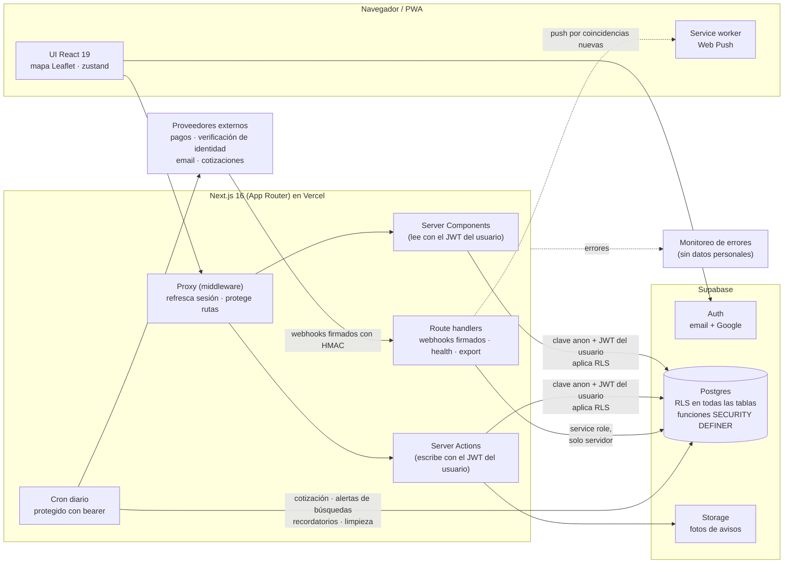

# Rock&Prop

**Una plataforma inmobiliaria con el mapa como protagonista, pensada primero para Argentina y después para Latinoamérica.**
Las inmobiliarias publican; los visitantes buscan en el mapa, agendan visitas y hacen ofertas. 
Pensada para cómo funciona de verdad el mercado argentino, con funciones únicas que ningún otro portal del mercado ofrece.

[English](README.md) · [Español](README.es.md)

> **Este es un repositorio vitrina.** El código fuente del producto es
> privado. Acá hay capturas, grabaciones y fragmentos de código
> simplificados e ilustrativos. Las capturas usan publicaciones de demo y
> los datos personales están ocultos.

---

## Contenido

- [Qué hace](#qué-hace)
- [Capturas](#capturas)
- [El proyecto en números](#el-proyecto-en-números)
- [Arquitectura](#arquitectura)
- [Tecnologías](#tecnologías)
- [Desafíos técnicos resueltos](#desafíos-técnicos-resueltos)
- [Pruebas y calidad](#pruebas-y-calidad)
- [Fragmentos de código](#fragmentos-de-código)

## Qué hace

| Para visitantes | Para inmobiliarias |
| --- | --- |
| Catálogo sobre el mapa: venta, alquiler y temporario | Panel con estadísticas, vistas y solicitudes pendientes |
| Búsqueda por radio ("cerca de mí"), por zona dibujada en el mapa o por barrio | Publicar con fotos, video y ubicación en el mapa |
| Filtros: tipo, precio en USD o pesos, dormitorios, baños, superficie | Importar un aviso desde un link, o muchos desde una planilla (CSV) |
| Agendar visitas, ofertar, pedir que te contacten, mensajes | Aceptar o rechazar ofertas y visitas; equipo y roles |
| Búsquedas guardadas con notificaciones push | Confirmación periódica de disponibilidad por email |
| Comparador de propiedades; instalable como PWA | Insignia de identidad verificada; destacados y planes |

Los precios se muestran en la moneda en que se publicaron, con la conversión
de referencia al dólar MEP del día.

## Capturas

<table>
  <tr>
    <td width="50%"> <b>Mapa + catálogo.</b> Pines y tarjetas sincronizados.</td>
    <td width="50%"> <b>Filtros.</b> Precio en cualquier moneda, comparado al dólar MEP.</td>
  </tr>
  <tr>
    <td> <b>Ficha.</b> Ubicación, características, disponibilidad confirmada, visita y oferta.</td>
    <td> <b>Inmobiliaria.</b> Insignia de identidad verificada y sus propiedades.</td>
  </tr>
</table>

   
  <b>Panel de la inmobiliaria.</b> Estadísticas, propiedades del equipo con su estado, exportación CSV, confirmación de disponibilidad en lote, importación y formulario para publicar.

<table>
  <tr>
    <td align="center"></td>
    <td align="center"></td>
    <td align="center"></td>
  </tr>
  <tr><td colspan="3" align="center"><b>Celular.</b> La misma app, con la lista primero y un botón flotante "Ver mapa"; probada con el perfil de un Pixel 7.</td></tr>
</table>

## El proyecto en números

Foto de la rama `main` del repositorio privado al 16 de octubre de 2026.

| | |
| --- | --- |
| **Desarrollo** | Desde el 10 de junio de 2026 · **207 commits** · **70 pull requests mergeados** |
| **Versiones** | **35 versiones con tag**, de `v0.1.0` a `v0.8.17`, cada una verificada en producción |
| **Código de la app** | **~20.500 líneas** de TypeScript/TSX · 24 páginas · 64 componentes · 20 módulos de server actions · 15 rutas de API |
| **Base de datos** | **67 migraciones**, ~7.800 líneas de SQL/PL·pgSQL (+ ~800 de scripts de reversión) |
| **Pruebas** | **~9.100 líneas** de código de prueba · 875 verificaciones de base · 369 de datos · 96 pruebas de navegador |
| **Total** | **~38.800 líneas** de código, sin contar documentación ni lockfiles |

## Arquitectura

**Principios de diseño**

- **Las reglas viven en la base de datos, no en la app.** Toda lectura y
  escritura usa el JWT del propio usuario, así que Row-Level Security aplica
  incluso a una llamada a la API armada a mano. Todo cambio de estado
  (aceptar una oferta, aprobar una visita, marcar vendida, registrar un pago)
  es una función `SECURITY DEFINER` que vuelve a verificar la propiedad del
  dato; esas tablas no tienen políticas de `UPDATE`.
- **La clave de servicio la usan solo dos cosas:** los webhooks firmados y las
  tareas programadas. Nunca un pedido que el usuario pueda armar.
- **Cada cambio de esquema es una migración numerada** (67 hasta ahora, con
  scripts de reversión para las riesgosas), aplicada primero en staging y
  verificada en producción comparando el hash del cuerpo de cada función.
- **Server Components por defecto;** al navegador solo viajan el mapa y lo
  interactivo.

## Tecnologías

| Capa | Tecnología | Por qué |
| --- | --- | --- |
| Framework | **Next.js 16** (App Router, Server Actions, Turbopack) | Render en el servidor; acciones en lugar de una API REST hecha a mano |
| UI | **React 19**, **Tailwind CSS 4**, íconos lucide | Iteración rápida y diseño consistente |
| Lenguaje | **TypeScript** (estricto) y **SQL / PL/pgSQL** | Tipos de punta a punta; reglas de negocio en la base |
| Base y autenticación | **Supabase**: Postgres, Auth (email + Google), Storage | Postgres administrado con RLS nativo |
| Mapas | **Leaflet** + react-leaflet, mosaicos de OpenStreetMap | Gratis y sin clave de API en el cliente |
| Estado | **zustand** | Mapa y lista sincronizados sin pasar props |
| Imágenes | **sharp** (servidor) + canvas (navegador) | Maestros WebP normalizados, sin EXIF ni GPS |
| Notificaciones | **Web Push** (VAPID) + email transaccional | Alertas con horario de silencio y tope diario |
| Pagos / KYC | Pasarela de pagos regional (Checkout), proveedor de verificación de identidad | Planes y destacados; insignia de inmobiliaria verificada |
| Observabilidad | **Sentry** sin recolección de datos personales; rutas de salud y monitoreo | Errores sin datos de las personas |
| Pruebas | **Playwright** (+ axe), **PGlite** (Postgres embebido), suite en vivo | Ver abajo |
| CI/CD | GitHub Actions, Vercel | `main` protegida, CI en verde antes de cada merge, backups nocturnos verificados |

## Desafíos técnicos resueltos

<b>1. Autorización que una llamada armada a mano no puede saltear</b>

Los controles en la app se saltean llamando directo a la API de la base. Por
eso todas las reglas son políticas de RLS más funciones definer, y la app se
conecta con el token del usuario. Un detalle sutil: un `INSERT … RETURNING`
también necesita una política de `SELECT`, o PostgREST rechaza la fila
recién insertada; las pruebas mandan exactamente la sentencia que manda
PostgREST para detectarlo.
→ [`snippets/sql/01-atomic-state-transition.sql`](snippets/sql/01-atomic-state-transition.sql)

<b>2. Ver la política que está realmente vigente</b>

Después de decenas de migraciones, ningún archivo muestra qué puede hacer un
rol. Un script lee el catálogo en vivo (políticas, permisos, triggers) e
imprime la matriz efectiva por rol. Revisar esa salida, y no las
migraciones, encontró problemas reales que se corrigieron y quedaron
cubiertos por pruebas.

<b>3. Transiciones de estado atómicas</b>

Aceptar una oferta reserva la propiedad y rechaza las demás en una sola
transacción; después, las políticas de inserción rechazan ofertas y visitas
nuevas sobre una propiedad reservada. No hay ningún momento con dos ofertas
aceptadas.
→ [`snippets/sql/01-atomic-state-transition.sql`](snippets/sql/01-atomic-state-transition.sql)

<b>4. Límites de uso dentro de RLS</b>

Postgres no acepta una política que consulte su propia tabla. El conteo pasa
a una función definer estable que solo cuenta las filas del que llama, y la
política de inserción compara contra ella (10 ofertas, 10 visitas y 30
mensajes por hora).
→ [`snippets/sql/02-rate-limit-inside-a-policy.sql`](snippets/sql/02-rate-limit-inside-a-policy.sql)

<b>5. Pagos idempotentes y a prueba de manipulación</b>

El webhook es lo único que marca una orden como pagada. Se verifica la
firma, se vuelve a consultar el pago al proveedor y el registro es
idempotente por el id del evento. Una orden desconocida devuelve un SQLSTATE
propio para que el proveedor deje de reintentar, sin ocultar las fallas
reales. Los precios se fijan en USD y se cobran en pesos a la cotización
del día.
→ [`snippets/sql/03-idempotent-webhook.sql`](snippets/sql/03-idempotent-webhook.sql)

<b>6. Importar un aviso desde cualquier link, sin SSRF</b>

El servidor lee una URL que pega el usuario. Solo `https` en el 443, sin
credenciales ni IPs literales; la respuesta del DNS se verifica **al
conectar**, sobre la misma dirección que usa el socket (contra DNS
rebinding); los rangos privados incluyen IPv6 con IPv4 adentro, NAT64, 6to4
y Teredo; cada redirección se revalida; hay tope de tamaño y de tiempo
total; se respeta robots.txt y las imágenes se verifican por sus bytes
iniciales.
→ [`snippets/typescript/ssrf-guard.ts`](snippets/typescript/ssrf-guard.ts)

<b>7. Fotos que cuidan la privacidad</b>

Las fotos se normalizan a un maestro WebP derecho (1920 px de lado mayor) en
el navegador, y con sharp en el servidor para las importadas. Se borran EXIF
y GPS (la foto de una casa tomada con el celular trae sus coordenadas) y un
límite de píxeles frena las bombas de descompresión. Las políticas de
Storage se basan en el id del dueño dentro de la ruta del archivo.

<b>8. Alertas de búsquedas guardadas sin duplicados</b>

Cada búsqueda guardada tiene una marca de agua, así que repetir la tarea
nocturna nunca manda dos veces la misma coincidencia. Un único predicado SQL
sirve al catálogo y a las alertas, de modo que "lo que ves" y "lo que te
avisan" no pueden diferir; una prueba compara 896 combinaciones de filtros.
Los push respetan horario de silencio, tope diario y no se repiten por aviso.

<b>9. Links firmados que sobreviven a los filtros de correo</b>

Los emails de "¿sigue disponible?" llevan tokens `id.vencimiento.HMAC`. Los
filtros de correo abren los links solos, así que abrir es solo lectura y
cada respuesta es un POST que vuelve a verificar el token; la base también
revisa el vencimiento.
→ [`snippets/typescript/signed-links.ts`](snippets/typescript/signed-links.ts)

<b>10. Precios en una economía bimonetaria</b>

Los avisos se publican en USD o en pesos y se muestran con la conversión de
referencia al dólar MEP y la fecha de la cotización. Los precios en pesos se
marcan como desactualizados con el tiempo; el historial de bajas de precio
lo escriben solo los triggers; y las ventanas de "disponibilidad
confirmada" están espejadas entre TypeScript y SQL, con una prueba que las
mantiene iguales.

<b>11. Monitoreo de errores sin datos personales</b>

Se apaga la recolección de usuario, cookies, encabezados, cuerpos, query
strings y variables locales, y las URLs que llevan un token se enmascaran en
todos los campos donde un evento puede repetirlas.
→ [`snippets/typescript/error-reporting-privacy.ts`](snippets/typescript/error-reporting-privacy.ts)

<b>12. Probar la base de datos sin la nube</b>

PGlite (Postgres compilado a WebAssembly) corre todas las migraciones y
cientos de verificaciones de RLS dentro del proceso, en segundos y sin red.
Otra suite prueba las mismas reglas con JWTs reales contra un proyecto de
staging, y Playwright recorre la app completa en escritorio y celular.

Además: exportaciones CSV protegidas contra inyección de fórmulas, `?next=`
sin redirecciones abiertas, comparación de secretos en tiempo constante para
el cron, ajustes de diseño para que todos los paneles se alcancen desde el
celular, y la primera foto en pantalla pedida con prioridad alta para un
Largest Contentful Paint más rápido.
→ [`snippets/typescript/web-hardening.ts`](snippets/typescript/web-hardening.ts)

## Pruebas y calidad

| Suite | Qué cubre | Tamaño |
| --- | --- | --- |
| **Base de datos (RLS)** | Todas las migraciones sobre Postgres embebido; quién puede leer y escribir qué, con cada rol | **875 verificaciones** |
| **Datos** | Conversores, dinero, vigencia, geometría, filtros, importación, CSV, seguridad de URLs | **369 verificaciones** |
| **De punta a punta** | Playwright en Chrome de escritorio y perfil Pixel 7, con revisión de accesibilidad (axe); cada cuenta de prueba se borra al terminar | **96 pruebas** en 31 archivos |
| **En vivo** | JWTs reales contra un proyecto de staging | flujo completo |

Flujo de trabajo: `main` protegida, rama → PR → CI en verde → merge con
rebase. Los cambios de base van primero a staging y después a producción,
verificados por hash. Cada versión verificada en producción lleva un tag
anotado. Producción tiene backup nocturno y la restauración se prueba.

## Fragmentos de código

La carpeta [`snippets/`](snippets) tiene extractos simplificados que ilustran
las técnicas de arriba. **Son ilustrativos, no el código de producción:** los
nombres son genéricos y se quitaron los detalles propios del proyecto. Los
comentarios están en inglés, como en el código original.

| Fragmento | Muestra |
| --- | --- |
| [`typescript/ssrf-guard.ts`](snippets/typescript/ssrf-guard.ts) | Chequeo de direcciones públicas, validación de URL, DNS verificado al conectar |
| [`typescript/signed-links.ts`](snippets/typescript/signed-links.ts) | Tokens HMAC con vencimiento, verificación en tiempo constante |
| [`typescript/web-hardening.ts`](snippets/typescript/web-hardening.ts) | Bearer, redirecciones seguras, inyección en CSV |
| [`typescript/error-reporting-privacy.ts`](snippets/typescript/error-reporting-privacy.ts) | Reportes de error sin datos personales |
| [`typescript/geo.ts`](snippets/typescript/geo.ts) | Distancia haversine y punto en polígono para zonas del mapa |
| [`sql/01-atomic-state-transition.sql`](snippets/sql/01-atomic-state-transition.sql) | Función definer en lugar de políticas de UPDATE |
| [`sql/02-rate-limit-inside-a-policy.sql`](snippets/sql/02-rate-limit-inside-a-policy.sql) | Límite de uso aplicado por RLS |
| [`sql/03-idempotent-webhook.sql`](snippets/sql/03-idempotent-webhook.sql) | Registro de pagos idempotente |

---

© 2026 Bruno Rapacini. Todos los derechos reservados. Ver <a href="LICENSE">LICENSE</a>.

