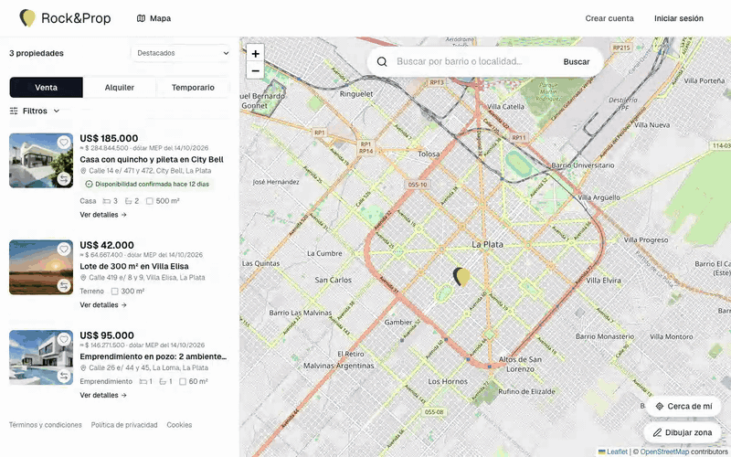
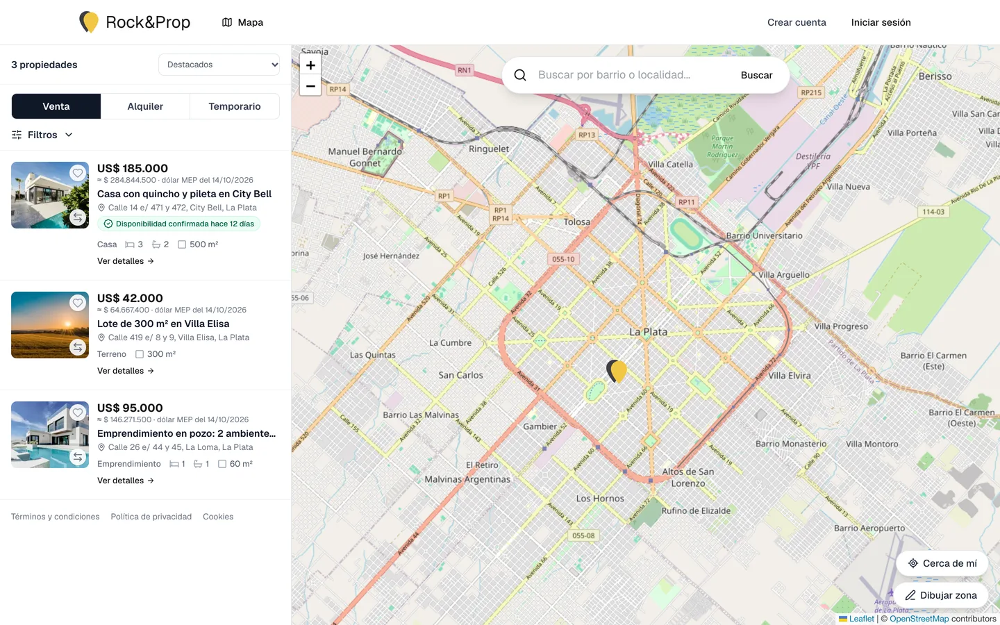
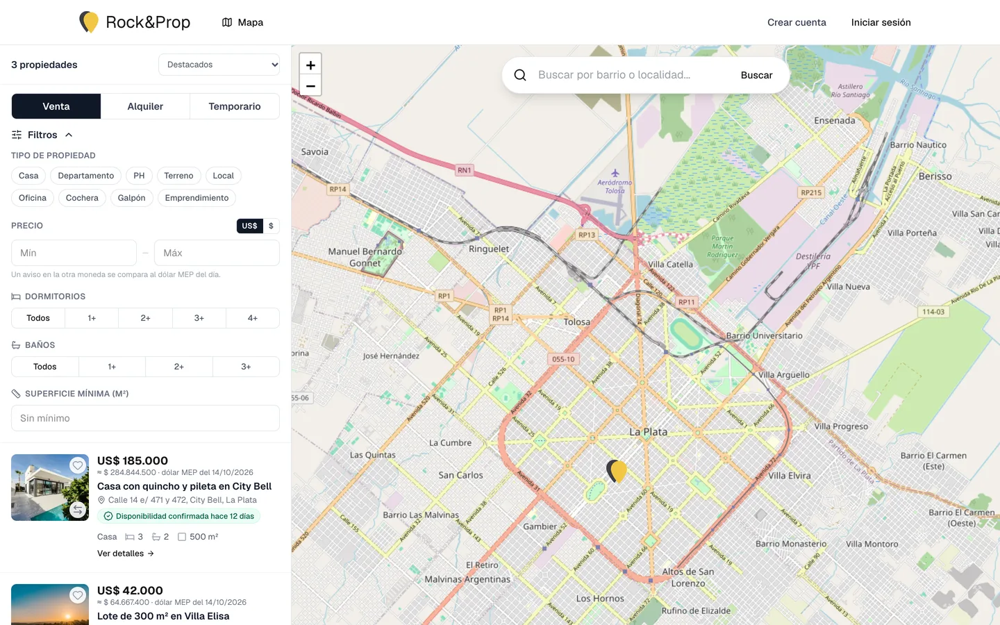
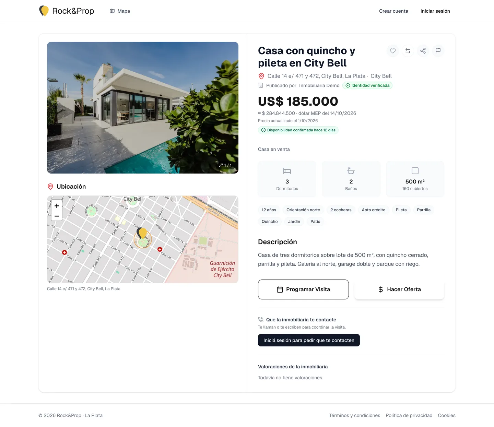
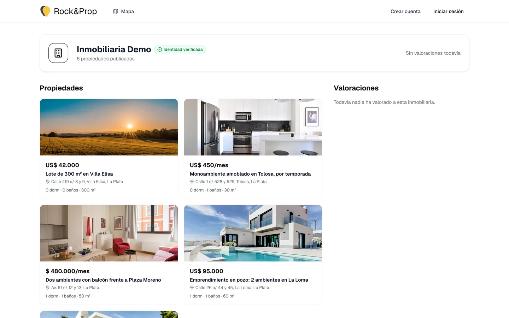
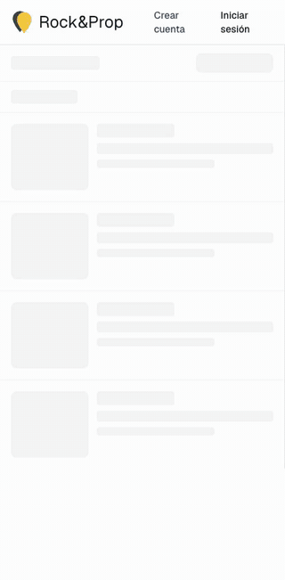
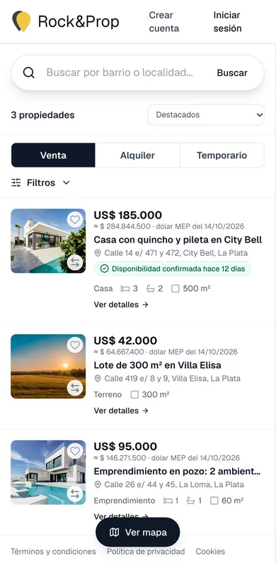
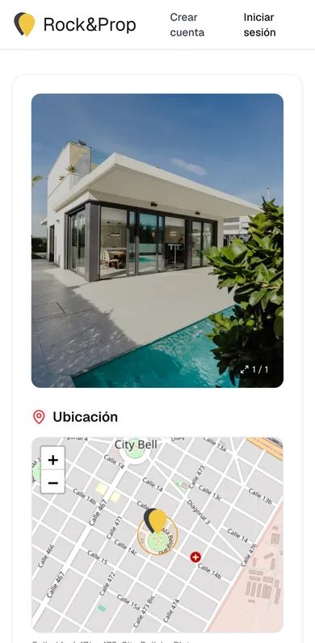
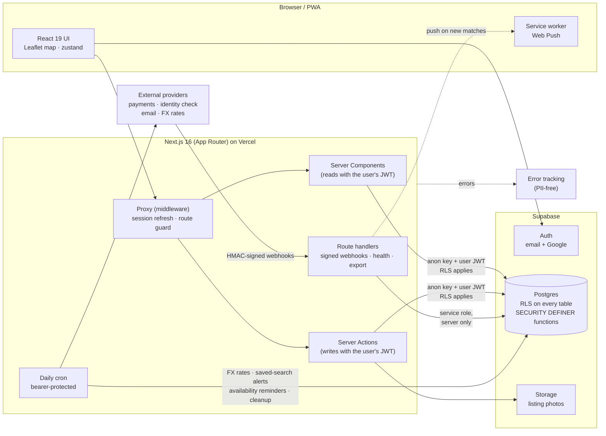

# Rock&Prop

**A map-first real-estate platform, built for Argentina first and Latin America next.**
Agencies publish listings; visitors search on a map, book viewings and make offers. 
Built around how the Argentine market really works, with features no other portal in the market offers.

[English](README.md) · [Español](README.es.md)

> **This is a showcase repository.** The product's source code is private.
> What you see here are screenshots, recordings and simplified, illustrative
> code snippets. Screenshots use demo listings; personal data is masked.

---

## Contents

- [What it does](#what-it-does)
- [Screenshots](#screenshots)
- [The project in numbers](#the-project-in-numbers)
- [Architecture](#architecture)
- [Tech stack](#tech-stack)
- [Technical challenges solved](#technical-challenges-solved)
- [Testing and quality](#testing-and-quality)
- [Code snippets](#code-snippets)

## What it does

| For visitors | For agencies |
| --- | --- |
| Map-first catalogue for sale, rent and short-term rent | Agency dashboard with listing stats, views and pending requests |
| Search by radius ("near me"), by a zone drawn on the map, or by neighbourhood | Publish listings with photos, video and a pin on the map |
| Filters: type, price in USD or ARS, bedrooms, bathrooms, surface | Import a listing from a link, or many from a spreadsheet (CSV) |
| Book a viewing, make an offer, ask to be contacted, message the agency | Accept or decline offers and viewings; team members and roles |
| Save searches and get push notifications for new matches | Periodic "still available?" confirmations by email |
| Compare listings side by side; installable as a PWA | Identity verification badge; featured listings and plans |

Prices are shown in the currency they were published in, with a reference
conversion at the day's MEP dollar rate, as is usual in Argentina.

## Screenshots

<table>
  <tr>
    <td width="50%"> <b>Map + catalogue.</b> Pins and cards stay in sync.</td>
    <td width="50%"> <b>Filters.</b> Price in either currency, compared at the MEP rate.</td>
  </tr>
  <tr>
    <td> <b>Listing page.</b> Location, features, availability badge, viewing and offer actions.</td>
    <td> <b>Agency page.</b> Verified identity badge and its listings.</td>
  </tr>
</table>

   
  <b>Agency dashboard.</b> Stats, the team's listings with status controls, CSV export, bulk availability confirmation, import, and the publish form.

<table>
  <tr>
    <td align="center"></td>
    <td align="center"></td>
    <td align="center"></td>
  </tr>
  <tr><td colspan="3" align="center"><b>Mobile.</b> Same app, list-first with a floating "map" button; tested on a Pixel 7 profile.</td></tr>
</table>

## The project in numbers

Snapshot of the private repository's `main` branch as of October 19, 2026.

| | |
| --- | --- |
| **Development** | Since June 10, 2026 · **231 commits** · **90 merged pull requests** |
| **Releases** | **48 tagged versions**, `v0.1.0` → `v0.8.30`, each verified in production |
| **Application code** | **~22,000 lines** of TypeScript/TSX · 28 pages · 68 components · 21 server-action modules · 15 API routes |
| **Database** | **78 migrations**, ~8,900 lines of SQL/PL·pgSQL written by hand (+ ~1,100 lines of reversal scripts), and ~8,600 rows of generated geographic data |
| **Tests** | **~9,900 lines** of test code · 990 database checks · 408 data checks · 108 browser tests |
| **Total** | **~43,200 lines** of code, excluding docs, lockfiles and generated data |

## Architecture

**Design principles**

- **The rules live in the database, not in the app.** Every read and write
  from the app goes through the user's own JWT, so Row-Level Security applies
  even to a hand-crafted API call. Anything that changes state (accept an
  offer, approve a viewing, mark a listing sold, record a payment) is a
  `SECURITY DEFINER` function that re-checks ownership; there are no
  `UPDATE` policies for those tables at all.
- **The service-role key is used by exactly two things:** signed webhooks and
  scheduled jobs. Never by a request a user can shape.
- **Every schema change is a numbered migration** (78 so far, with reversal
  scripts for the risky ones), applied by a script that records each one in
  the same transaction: staging first, then production, and the two compared
  by a fingerprint of every function, grant, policy, trigger and reference
  table.
- **Server Components by default;** the client bundle carries the map and the
  interactive bits only.

## Tech stack

| Layer | Technology | Why |
| --- | --- | --- |
| Framework | **Next.js 16** (App Router, Server Actions, Turbopack) | Server-first rendering, actions instead of a hand-rolled REST API |
| UI | **React 19**, **Tailwind CSS 4**, lucide icons | Fast iteration, consistent design tokens |
| Language | **TypeScript** (strict) and **SQL / PL/pgSQL** | Types end to end; business rules in the database |
| Database & auth | **Supabase**: Postgres, Auth (email + Google), Storage | RLS-native, managed Postgres |
| Maps | **Leaflet** + react-leaflet, vector tiles from **OpenFreeMap** (MapLibre GL, OpenStreetMap data) | Free, no API key, commercial use allowed |
| Geography | Georef AR and INDEC (CC BY 4.0), city barrio maps, OpenStreetMap outlines (ODbL) | Every pin resolves to its locality across the whole country |
| State | **zustand** | Map ↔ list synchronisation without prop drilling |
| Images | **sharp** (server) + canvas (browser) | Normalised WebP masters, EXIF/GPS stripped |
| Notifications | **Web Push** (VAPID) + transactional email | Saved-search alerts with quiet hours and a daily cap |
| Payments / KYC | Regional payment gateway (Checkout), identity-verification provider | Plans and featured listings; verified-agency badge |
| Observability | **Sentry** with all PII collection disabled; health and monitoring routes | Errors without personal data |
| Testing | **Playwright** (+ axe accessibility), **PGlite** (embedded Postgres), live suite | See below |
| CI/CD | GitHub Actions, Vercel | Protected `main`, green CI before every merge, nightly verified backups |

## Technical challenges solved

<b>1. Authorisation that a crafted API call cannot bypass</b>

App-level checks are skipped by anyone who calls the database API directly.
All rules are therefore Row-Level Security policies plus definer functions,
and the app connects with the user's own token. A subtle one: an
`INSERT … RETURNING` also needs a matching `SELECT` policy, otherwise
PostgREST rejects the inserter's own row — the test suite sends exactly the
statement PostgREST sends to catch this.
→ [`snippets/sql/01-atomic-state-transition.sql`](snippets/sql/01-atomic-state-transition.sql)

<b>2. Seeing the policy that is actually in force</b>

After dozens of migrations, no single file shows what a role may do. A
script reads the live catalog (policies, grants, triggers) and prints the
effective matrix per role. Reviewing that output, rather than the migration
files, found real issues that were then fixed and covered by tests.

<b>3. Atomic state transitions</b>

Accepting an offer reserves the listing and rejects every rival offer in one
transaction; the insert policies then refuse new offers and viewings on a
reserved listing. There is no window where two offers are both accepted.
→ [`snippets/sql/01-atomic-state-transition.sql`](snippets/sql/01-atomic-state-transition.sql)

<b>4. Rate limits enforced by RLS</b>

Postgres refuses a policy that queries its own table. The count moves into a
stable definer function that only counts the caller's rows, and the insert
policy compares against it (10 offers, 10 viewings, 30 messages per hour).
→ [`snippets/sql/02-rate-limit-inside-a-policy.sql`](snippets/sql/02-rate-limit-inside-a-policy.sql)

<b>5. Payments that are idempotent and tamper-proof</b>

The webhook is the only path that marks an order paid. Signature verified,
payment re-fetched from the provider, recording idempotent on the event id.
An unknown order raises a distinct SQLSTATE so the provider stops retrying
while genuine failures still alert. Prices are set in USD and charged in ARS
at the day's rate.
→ [`snippets/sql/03-idempotent-webhook.sql`](snippets/sql/03-idempotent-webhook.sql)

<b>6. Import a listing from any link, without SSRF</b>

The server fetches a user-supplied URL. Only `https` on 443, no credentials,
no IP literals; the DNS answer is checked **at connect time** on the very
address the socket uses (defeats DNS rebinding); private ranges include
IPv4-mapped IPv6, NAT64, 6to4 and Teredo; redirects re-validated; size and
total-time caps; robots.txt respected; images verified by magic bytes.
→ [`snippets/typescript/ssrf-guard.ts`](snippets/typescript/ssrf-guard.ts)

<b>7. A photo pipeline that protects privacy</b>

Photos are normalised to an upright WebP master (1920 px long side) in the
browser, and with sharp on the server for imported photos. EXIF and GPS are
stripped (a phone photo of a house carries its coordinates), and a pixel
limit guards against decompression bombs. Storage policies key off the
owner's id in the object path.

<b>8. Saved-search alerts with no duplicates</b>

A watermark per saved search means a re-run of the nightly job can never
send the same match twice. One SQL predicate serves both the catalogue and
the alerts, so "what you see" and "what you're alerted about" cannot
disagree; a test checks 896 filter combinations against the spec. Push
delivery respects quiet hours, a daily cap and per-listing de-duplication.

<b>9. Signed links that survive mail scanners</b>

"Is this listing still available?" emails carry `id.expiry.HMAC` tokens.
Corporate mail filters open links automatically, so opening is read-only and
every answer is a POST that re-verifies the token; the database re-checks
expiry too.
→ [`snippets/typescript/signed-links.ts`](snippets/typescript/signed-links.ts)

<b>10. Pricing in a bimonetary economy</b>

Listings are priced in USD or ARS, shown with a reference conversion at the
MEP rate and the date it was quoted. Peso prices get a staleness flag;
price-drop history is written only by triggers; listing "freshness" windows
are mirrored between TypeScript and SQL with a test holding them equal.

<b>11. Error tracking without personal data</b>

The SDK's collection of user info, cookies, headers, bodies, query strings
and local variables is switched off, and URLs that carry a token are masked
in every field an event can repeat them.
→ [`snippets/typescript/error-reporting-privacy.ts`](snippets/typescript/error-reporting-privacy.ts)

<b>12. Testing the database without a cloud</b>

PGlite (Postgres compiled to WebAssembly) runs every migration and hundreds
of RLS assertions in-process, in seconds, with no network. A separate live
suite proves the same rules with real JWTs against a deployed staging
project, and Playwright drives the full app on desktop and mobile.

<b>13. Every pin lands in the right town, across the whole country</b>

Argentina's official gazetteer gives its 3,923 localities as points, with no
outline, and in a metropolitan area the nearest centre is often the wrong
town. A pin is resolved in layers, in plain Postgres (bounding boxes first,
then point-in-polygon in SQL): the locality's own outline where there is
one, from the cities' barrio maps (Buenos Aires, Rosario, Córdoba, Mar del
Plata, Mendoza) and OpenStreetMap for 194 localities of Greater Buenos
Aires and 37 districts of the Gran Mendoza; then the census polygon that holds the point, and the nearest centre
within it; last, the nearest centre within 40 km. Each source arrives as a
generated migration, simplified to ~20 m, and is credited with its licence.
A test walks all 3,923 centres and requires each to land in its own
locality, naming one by one the few that a neighbour's outline absorbs on
purpose; a change to the overlap rule is simulated over all of them first.

Also: CSV formula-injection guard on exports, open-redirect-safe `?next=`,
constant-time secret comparison for cron routes, mobile-first layout fixes
so every panel is reachable on a phone, and the first on-screen photo
fetched with high priority for a faster Largest Contentful Paint.
→ [`snippets/typescript/web-hardening.ts`](snippets/typescript/web-hardening.ts)

## Testing and quality

| Suite | What it covers | Size |
| --- | --- | --- |
| **Database (RLS)** | All migrations on embedded Postgres; who can read/write what, as each role; every locality's centre lands in it | **990 checks** |
| **Data** | Mappers, money, freshness, geometry, filters, import parsing, CSV, URL safety | **408 checks** |
| **End-to-end** | Playwright on desktop Chrome and a Pixel 7 profile, with axe accessibility scans; every test account cleans up after itself | **108 tests** in 33 spec files |
| **Live** | Real JWTs against a deployed staging project | full user flow |

Workflow: protected `main`, branch → green CI on the Node version production
runs → PR → rebase merge. Migrations go to staging first, then production,
and the two are compared item by item by a read-only fingerprint. Every
release verified in production gets an annotated tag. Production is backed
up nightly and the restore is tested every month.

## Code snippets

The [`snippets/`](snippets) folder holds simplified excerpts that illustrate
the techniques above. They are **illustrative, not the production code**:
names are generic and project-specific details are removed.

| Snippet | Shows |
| --- | --- |
| [`typescript/ssrf-guard.ts`](snippets/typescript/ssrf-guard.ts) | Public-address check, URL validation, connect-time DNS guard |
| [`typescript/signed-links.ts`](snippets/typescript/signed-links.ts) | HMAC tokens with expiry, constant-time verification |
| [`typescript/web-hardening.ts`](snippets/typescript/web-hardening.ts) | Bearer check, safe redirects, CSV injection guard |
| [`typescript/error-reporting-privacy.ts`](snippets/typescript/error-reporting-privacy.ts) | PII-free error reporting |
| [`typescript/geo.ts`](snippets/typescript/geo.ts) | Haversine distance and point-in-polygon for map zones |
| [`sql/01-atomic-state-transition.sql`](snippets/sql/01-atomic-state-transition.sql) | Definer function instead of UPDATE policies |
| [`sql/02-rate-limit-inside-a-policy.sql`](snippets/sql/02-rate-limit-inside-a-policy.sql) | Rate limit enforced by RLS |
| [`sql/03-idempotent-webhook.sql`](snippets/sql/03-idempotent-webhook.sql) | Idempotent payment recording |

---

© 2026 Bruno Rapacini. All rights reserved. See <a href="LICENSE">LICENSE</a>.

